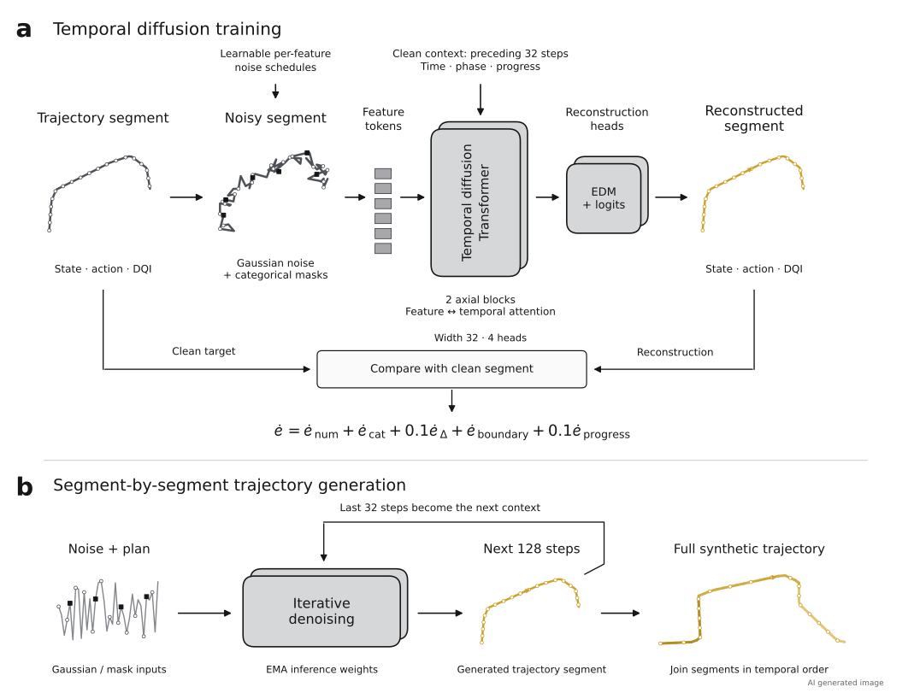
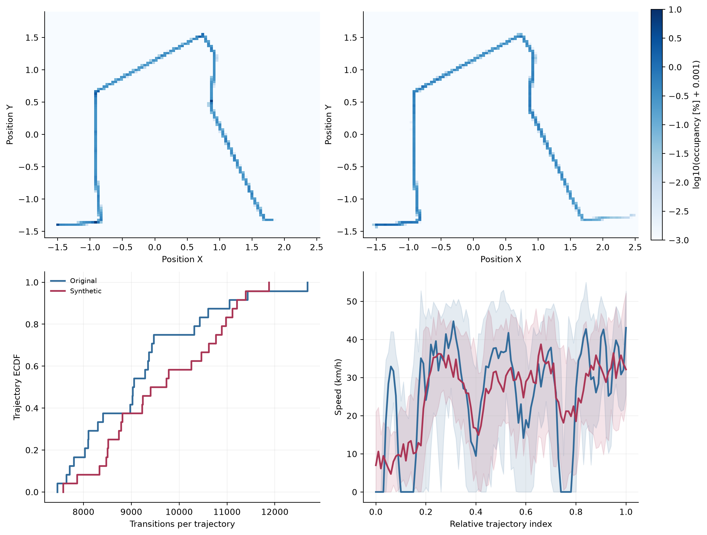
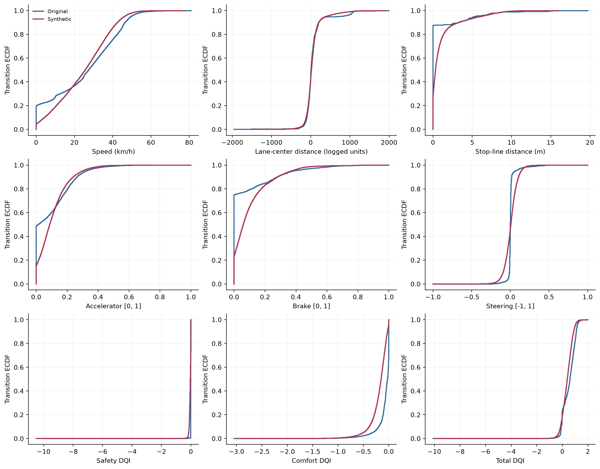
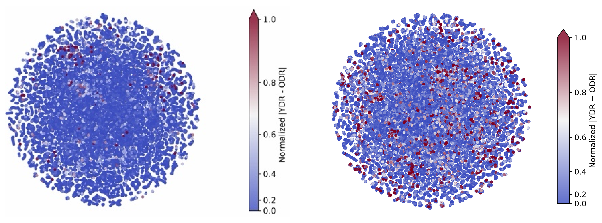
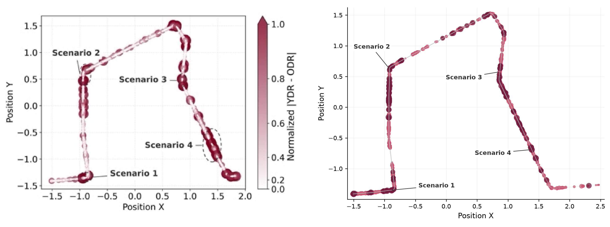
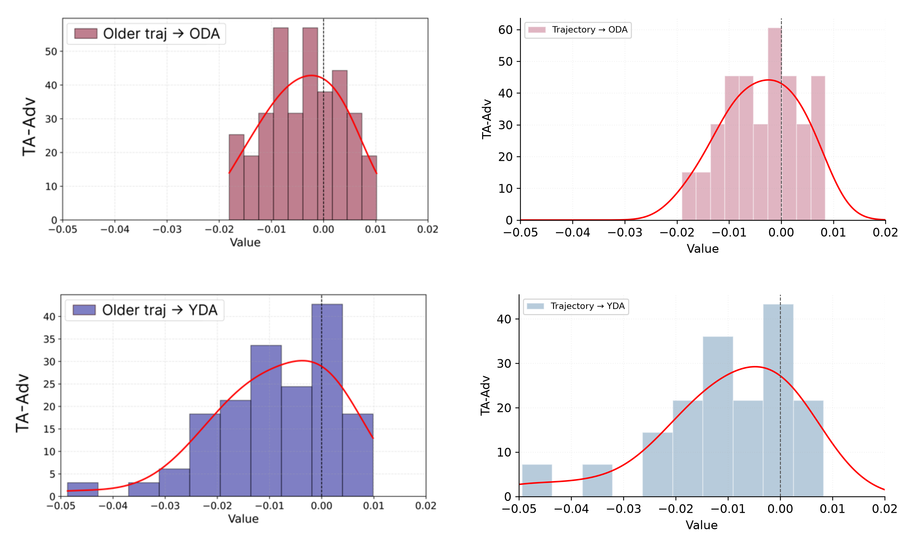
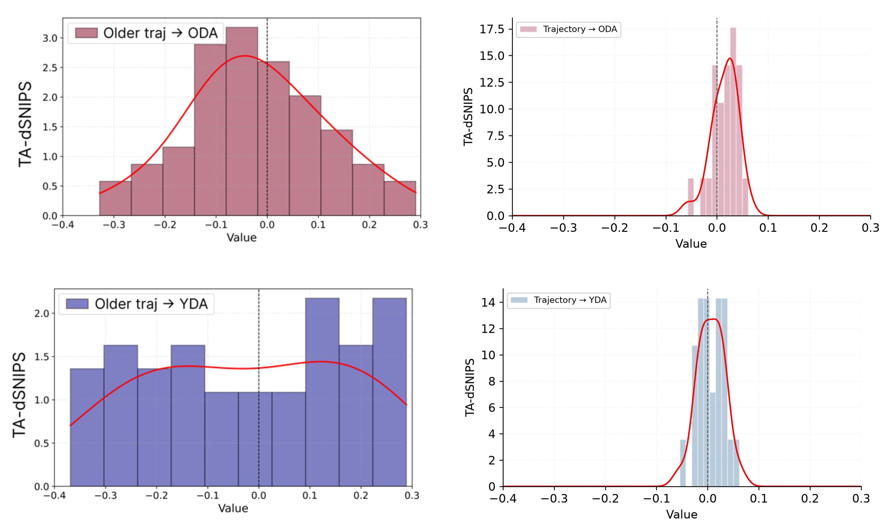
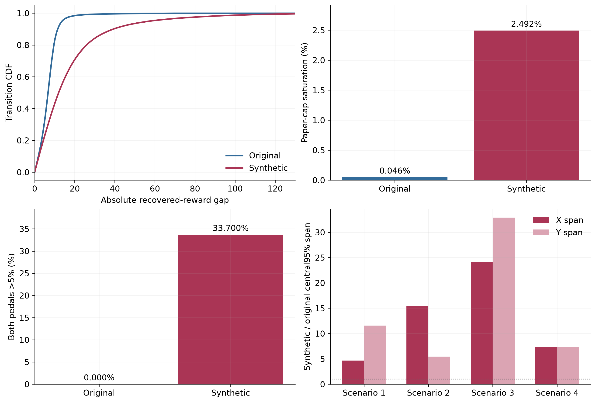
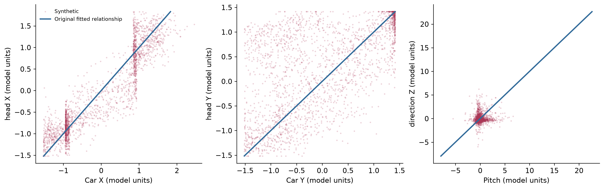

# Driving-IRL

The original driving data were collected at a hospital and cannot be shared publicly because of privacy concerns. We therefore use **24 synthetic driving trajectories generated using diffusion** to support reproduction of the code and analysis workflow. The dataset comprises 12 younger-group and 12 older-group trajectories, with **232,525 transitions** in total.

The synthetic data demonstrate the preprocessing, training, evaluation and figure-generation workflow. They show trends similar to the original results in road geometry, TA distributions and recovered-reward differences in some scenario regions.

The synthetic dataset is split into 10 training and 2 validation trajectories per cohort only for optional training examples. The fixed ODA/YDA IRL policies and comparison BC policies trained on the original data are provided separately in `reproduction_inputs/policies/`.

### Synthetic data generation model

We trained separate temporal diffusion models on the younger and older training data. Our implementation extends [TabDiff (Shi et al., ICLR 2025)](https://proceedings.iclr.cc/paper_files/paper/2025/hash/5c882988ce5fac487974ee4f415b96a9-Abstract-Conference.html), which jointly models numerical and categorical variables, to driving time series. Numerical reconstruction uses the preconditioning and weighted denoising objective of [EDM (Karras et al., NeurIPS 2022)](https://arxiv.org/abs/2206.00364).

Each variable is embedded as a token and processed by a **Transformer that alternates feature attention and temporal attention**. The model uses a hidden width of 32, four attention heads and two blocks, each containing both attention types. Gaussian noise is applied to numerical variables and mask noise to categorical variables, with learnable per-feature noise schedules. The preceding 32 transitions condition the joint generation of the next 128 transitions; successive segments are concatenated to form a complete trajectory. The implementation is provided in [diffusion.py](../../synthetic_generation/diffusion.py).



The training objective is

$$
\mathcal L = \mathcal L_{\mathrm{num}} + \mathcal L_{\mathrm{cat}} + 0.1\mathcal L_{\Delta} + \mathcal L_{\mathrm{boundary}} + 0.1\mathcal L_{\mathrm{progress}}.
$$

- $\mathcal L_{\mathrm{num}}$: numerical reconstruction MSE weighted by $(\sigma^2+1)/\sigma^2$.
- $\mathcal L_{\mathrm{cat}}$: noise-schedule-weighted cross-entropy for masked categorical variables.
- $\mathcal L_{\Delta}$: MSE matching adjacent-step changes in the reconstructed and original sequences.
- $\mathcal L_{\mathrm{boundary}}$: error in the change across the boundary between the preceding context and the newly generated segment.
- $\mathcal L_{\mathrm{progress}}$: smooth-L1 loss on cumulative displacement errors along the road.

The temporal-change, boundary and cumulative-displacement terms were added to support connected driving segments.

## 1. Original and synthetic data comparison

We compared road geometry, trajectory length and speed profiles. In the upper two panels, the original data are shown on the left and the synthetic data on the right. The lower panels show the trajectory-length distribution and the median speed profile with its 10–90% range.



We also compared the marginal distributions of states, actions and DQI rewards. The overall road geometry and some distributions are similar, while pedal use and some reward components differ. The Wasserstein distance for speed is 3.58 km/h, and the KS distance for lane-center distance is 0.059.



## 2. OPE results

We used the IRL and BC policies trained on the original data and the FQE evaluators from the original experiments. Each policy was evaluated on 12 synthetic trajectories generated for the corresponding group. Means and 95% confidence intervals are reported below.

<table>
<thead>
<tr><th></th><th></th><th colspan="2">DR</th><th colspan="2">FQE</th><th colspan="2">K-WIS</th></tr>
<tr><th>DQIs</th><th>Policy</th><th>Mean</th><th>95% CI</th><th>Mean</th><th>95% CI</th><th>Mean</th><th>95% CI</th></tr>
</thead>
<tbody>
<tr><td rowspan="4">Safety</td><td>Older-IRL</td><td align="right">1.188</td><td align="right">[-1.68, 5.98]</td><td align="right">-0.996</td><td align="right">[-1.49, -0.51]</td><td align="right">-3.464</td><td align="right">[-7.12, -1.81]</td></tr>
<tr><td>Older-BC</td><td align="right">-1.552</td><td align="right">[-1.80, -1.32]</td><td align="right">-1.465</td><td align="right">[-1.62, -1.29]</td><td align="right">-3.464</td><td align="right">[-7.12, -3.46]</td></tr>
<tr><td>Younger-IRL</td><td align="right">-1.872</td><td align="right">[-5.85, 3.11]</td><td align="right">-2.390</td><td align="right">[-4.11, -1.33]</td><td align="right">-6.801</td><td align="right">[-9.70, -3.60]</td></tr>
<tr><td>Younger-BC</td><td align="right">-4.429</td><td align="right">[-8.46, -1.66]</td><td align="right">-3.561</td><td align="right">[-7.27, -1.57]</td><td align="right">-6.801</td><td align="right">[-9.70, -3.60]</td></tr>
<tr><td rowspan="4">Traffic-Rule Compliance</td><td>Older-IRL</td><td align="right">1.737</td><td align="right">[-1.69, 7.20]</td><td align="right">-1.862</td><td align="right">[-2.55, -1.18]</td><td align="right">0.000</td><td align="right">[-0.03, 0.00]</td></tr>
<tr><td>Older-BC</td><td align="right">-0.273</td><td align="right">[-0.44, -0.16]</td><td align="right">-0.234</td><td align="right">[-0.41, -0.12]</td><td align="right">0.000</td><td align="right">[-0.03, 0.00]</td></tr>
<tr><td>Younger-IRL</td><td align="right">-0.170</td><td align="right">[-1.70, 1.47]</td><td align="right">-0.326</td><td align="right">[-0.66, 0.00]</td><td align="right">0.000</td><td align="right">[-0.08, 0.00]</td></tr>
<tr><td>Younger-BC</td><td align="right">-0.085</td><td align="right">[-0.23, 0.14]</td><td align="right">-0.177</td><td align="right">[-0.23, -0.12]</td><td align="right">0.000</td><td align="right">[-0.08, 0.00]</td></tr>
<tr><td rowspan="4">Comfort</td><td>Older-IRL</td><td align="right">-1.581</td><td align="right">[-4.97, 2.35]</td><td align="right">-1.463</td><td align="right">[-3.65, 0.58]</td><td align="right">-17.189</td><td align="right">[-25.21, -17.12]</td></tr>
<tr><td>Older-BC</td><td align="right">-8.704</td><td align="right">[-9.75, -7.82]</td><td align="right">-8.295</td><td align="right">[-9.10, -7.65]</td><td align="right">-17.189</td><td align="right">[-25.21, -17.12]</td></tr>
<tr><td>Younger-IRL</td><td align="right">-14.040</td><td align="right">[-25.62, -7.23]</td><td align="right">-6.960</td><td align="right">[-7.66, -6.28]</td><td align="right">-16.750</td><td align="right">[-22.32, -16.75]</td></tr>
<tr><td>Younger-BC</td><td align="right">-9.110</td><td align="right">[-11.01, -7.90]</td><td align="right">-8.202</td><td align="right">[-8.68, -7.76]</td><td align="right">-16.750</td><td align="right">[-22.32, -16.75]</td></tr>
<tr><td rowspan="4">Efficiency</td><td>Older-IRL</td><td align="right">115.713</td><td align="right">[77.64, 176.91]</td><td align="right">80.750</td><td align="right">[68.36, 92.93]</td><td align="right">22.787</td><td align="right">[20.02, 26.97]</td></tr>
<tr><td>Older-BC</td><td align="right">39.384</td><td align="right">[29.71, 48.37]</td><td align="right">43.022</td><td align="right">[36.50, 49.72]</td><td align="right">22.787</td><td align="right">[20.02, 26.97]</td></tr>
<tr><td>Younger-IRL</td><td align="right">85.478</td><td align="right">[5.61, 192.08]</td><td align="right">43.279</td><td align="right">[38.48, 47.78]</td><td align="right">15.866</td><td align="right">[15.87, 44.16]</td></tr>
<tr><td>Younger-BC</td><td align="right">14.324</td><td align="right">[-21.42, 36.26]</td><td align="right">28.918</td><td align="right">[22.00, 36.98]</td><td align="right">15.866</td><td align="right">[15.87, 44.16]</td></tr>
<tr><td rowspan="4">Total</td><td>Older-IRL</td><td align="right">117.058</td><td align="right">[74.21, 186.07]</td><td align="right">76.428</td><td align="right">[62.69, 90.17]</td><td align="right">2.134</td><td align="right">[-4.25, 2.13]</td></tr>
<tr><td>Older-BC</td><td align="right">28.855</td><td align="right">[18.59, 37.75]</td><td align="right">33.028</td><td align="right">[26.84, 39.18]</td><td align="right">2.134</td><td align="right">[-4.25, 2.13]</td></tr>
<tr><td>Younger-IRL</td><td align="right">69.397</td><td align="right">[-8.30, 168.68]</td><td align="right">33.603</td><td align="right">[28.87, 37.76]</td><td align="right">-7.685</td><td align="right">[-7.69, 16.49]</td></tr>
<tr><td>Younger-BC</td><td align="right">0.701</td><td align="right">[-38.21, 24.67]</td><td align="right">16.978</td><td align="right">[8.96, 25.76]</td><td align="right">-7.685</td><td align="right">[-7.69, 16.49]</td></tr>
</tbody>
</table>

## 3. t-SNE

**Left: original paper Figure 5c. Right: synthetic data.** The 232,525 synthetic states are visualized using t-SNE. Colors indicate the difference between rewards recovered by ODA and YDA.



## 4. Position-based recovered reward

**Left: original paper Figure 5d. Right: synthetic data.**



The reward scale differs substantially between the original and synthetic data. Nevertheless, visualizing regions with large reward differences reveals pronounced ODA–YDA differences around the scenario regions, with spatial trends similar to those in the original paper.

## 5. TA distributions

In each figure, **the original paper Figure 6a is shown on the left and the synthetic data on the right**. The upper row compares against ODA and the lower row against YDA. The paper shows older-driver trajectories, whereas the synthetic panels include all 24 trajectories.

TA-Adv.



TA-dSNIPS.



## 6. Limitations of the synthetic data

Although the synthetic data show similar road geometry and trends in some metrics, they do not fully reproduce temporal state changes, relationships between variables or the spatial extent of scenario regions. The following diagnostics compare the original and synthetic trajectories.



The mean absolute recovered-reward difference is 7.1124 for the original data and 18.0553 for the synthetic data. Both accelerator and brake exceed 5% simultaneously in 0.00% of original transitions and 33.70% of synthetic transitions. The central 95% range of Position Y in Scenario 3 is approximately 32.9 times wider in the synthetic data.



The correlation between vehicle Y and head Y is approximately 1.000 in the original data and 0.600 in the synthetic data. The correlation between pitch and direction Z is approximately 1.000 and 0.098, respectively. The original-data panels show fitted relationships using all observations, while the synthetic panels display a subset of states.

## Regenerating the figures

```bash
# Python 3.11+; run from the repository root (vr_github_latest/).
python -m pip install -r requirements-figures.txt
python -m synthetic_generation.figures --output outputs/figures
```
